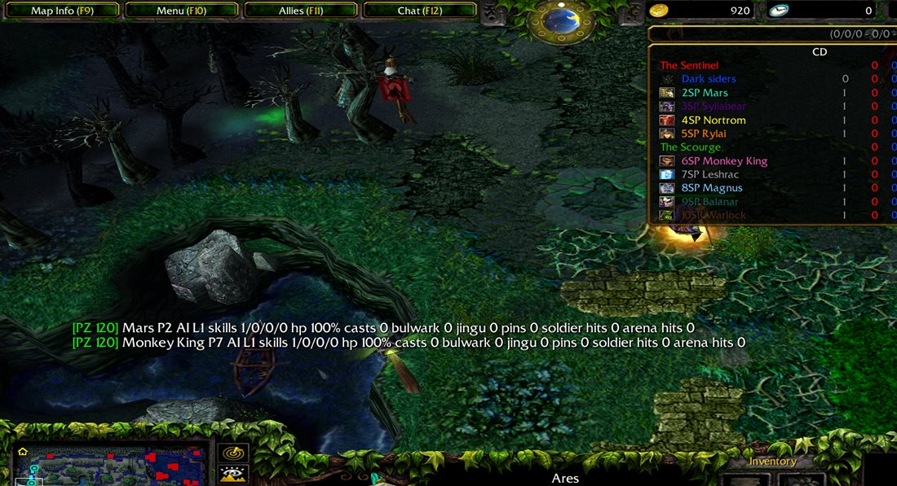
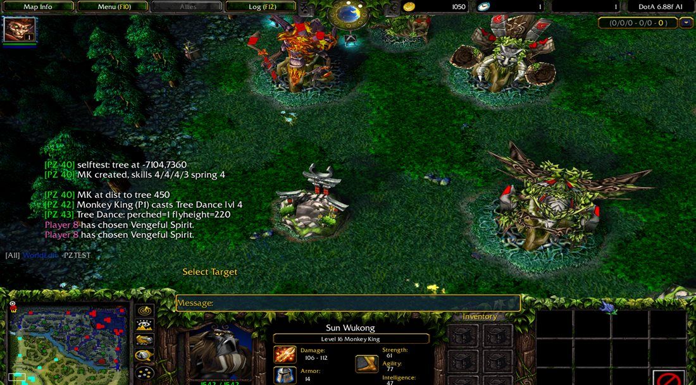
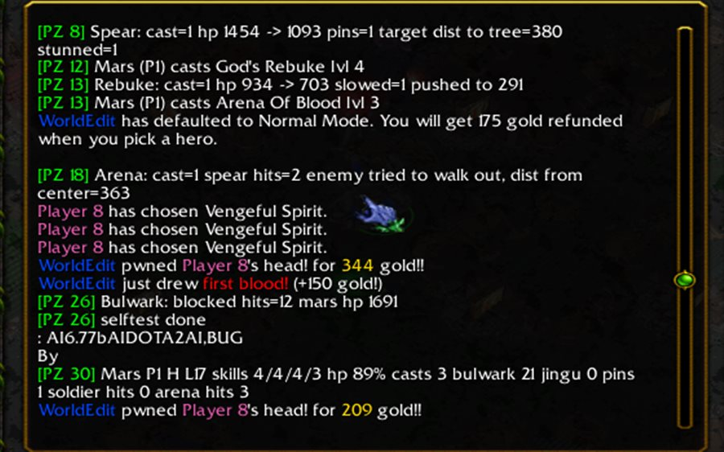
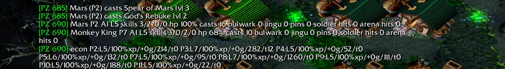

# DotA 1 AI maps + Claude as your opponent (Warcraft III 1.27b)

This project has two parts:
- **Five enhanced DotA 1 (Warcraft III) maps.** They run on the classic Warcraft III **1.27b** client and you play them against computer bots.
- **An MCP server that lets Claude join a live LAN game as an enemy hero.** Claude picks a hero, reads the game state and plays against a human in real time.

One of the maps adds two **Dota 2 heroes, Monkey King and Mars**, to the DotA 6.88 AI map, with bots that can play them. No public DotA AI map had Dota 2 heroes before this.

The whole project was built in collaboration with **Claude Code** (Anthropic). The work covered:
- reverse-engineering obfuscated map scripts;
- finding Warcraft III script-compiler limits;
- writing an MPQ archive writer;
- rewriting hero spells in JASS;
- building and testing the MCP bridge.

## What's inside

| Map (lobby name) | File | What it is |
|---|---|---|
| **DotA AI 6.88 MK+Mars** | `maps/DotA_688_AI_Superpower_MK_Mars.w3x` | The 6.88f AI map with **Monkey King** and **Mars** added (spells rewritten for 1.27b). Bots get normal gold and XP and retreat earlier when outnumbered. |
| **DotA 6.88f AI vs Claude** | `maps/DotA_6_88f_AI_vs_Claude.w3x` | The map used with the MCP server: Claude controls one enemy hero. |
| **DotA AI 6.8G9b** | `maps/DotA_6_88f_AI_Superpower_EN.w3x` | The 6.88f AI map with the "Superpower" AI layer, translated to English, with its 1.27b loading crash fixed. |
| **DotA v6.83d CN Fixed** | `maps/DotA_v6.83d_CN_fixed.w3x` | A Chinese-platform DotA 6.83d (KK/11) made playable on vanilla Warcraft III, shrunk from 64 MB to 9 MB. |
| **SG DotA v7.15 AI Superpower** | `maps/SG_DotA_v7.15_AI_Superpower.w3x` | SG DotA 7.15 AI with a stronger bot layer: auto skill-learning, spell casting and retreat. |

The [maps/README.md](maps/README.md) file has details, test results and known limits for each map.

| Folder | Contents |
|---|---|
| [`mcp-server/`](mcp-server/) | The **wc3-dota MCP server** (Python, standard library only). It also holds the in-map bridge (JASS), the map patcher, a hero/skill/item knowledge base, and the `/play-dota` Claude skill. |
| [`heroport/`](heroport/) | The pipeline that builds the Monkey King + Mars map: asset extractor, SLK/MPQ editors, the JASS spell code, and test scripts. |
| [`docs/`](docs/) | [DEVELOPMENT.md](docs/DEVELOPMENT.md) (the technical story and the problems solved) and screenshots. |

## Quick start: play against bots
1. You need **Warcraft III: The Frozen Throne 1.27b**.
2. Copy the `.w3x` files from `maps/` into `Warcraft III\Maps\Scenario\` (or any folder under `Maps`).
3. In the game, open **Local Area Network → Create Game** and pick a map. Set the other slots to **Computer (Insane)**, then start.
4. In the first seconds of the game, type a mode as the host, for example `-ap` (all pick) or `-sd` (single draft).
   - In **DotA AI 6.88 MK+Mars**, Monkey King is in Vengeful Spirit's tavern and Mars is in the tavern that has 4 heroes. Bots also pick them.

## Quick start: play against Claude
See [mcp-server/README.md](mcp-server/README.md). In short:
1. Copy `mcp-server/` into your Warcraft III folder.
2. Register the server with Claude Code.
3. Set the registry value `Allow Local Files = 1`.
4. Host **"DotA 6.88f AI vs Claude"** on LAN with one Computer slot on the enemy team.
5. Type `/play-dota` in Claude Code.

Claude then picks a hero, chats in game with `[All] Claude: ...`, casts skills, buys items and retreats. It only sees what its own team sees.

## Monkey King and Mars

| Hero | Spells (all rewritten in plain JASS for 1.27b) |
|---|---|
| **Monkey King** (Agility) | **Boundless Strike**: a stun and a crit along a 1,100-range line. **Tree Dance**: jump onto a tree and perch there. **Primal Spring**: a channelled leap whose damage and slow grow with channel time. **Jingu Mastery**: the 4th hit on the same hero gives 4 charged attacks with bonus damage and lifesteal. **Wukong's Command**: a ring of soldiers that attack heroes, plus bonus armor. |
| **Mars** (Strength) | **Spear of Mars**: skewers the first hero hit and pins it to a tree, cliff or building for a stun. **God's Rebuke**: a cone crit with knockback and slow. **Bulwark**: blocks 40–70% of attack damage from the front and 20–35% from the sides. **Arena of Blood**: a ring of soldiers that keeps enemies in or out and spears heroes at the edge. |

How the heroes were made:
- Models, icons, stats and tooltips come from DracoL1ch's DotA 7.03R11.
- DracoL1ch's own spell code only runs on the 1.26a client with a memory hack, so every spell was rewritten from scratch.
- The bots learn skills through the map's AI tables and buy items from builds borrowed from similar heroes (Juggernaut and Axe). They cast spells through a new AI routine.
- When low on HP, Monkey King escapes with Tree Dance and Mars pushes chasers away with Spear.

Verified in game:
- A 22-minute LAN match against 9 Insane bots.
- An automatic self-test of all 8 spells: perch and leap, stun, Jingu charges, Spear pin, Arena walls and the Bulwark block.

## Fair bots: normal gold and XP
The original 6.88 AI and its "Superpower" layer secretly gave Insane bots extra resources:
- up to **+140% XP**;
- about **3× the passive gold**;
- about 600 bonus starting gold;
- "catch-up" gold and XP every time they died.

The MK+Mars map removes all of these. Bots play at 100% XP and normal gold. To compensate, they got better at staying alive: a bot that is outnumbered by nearby enemy heroes retreats at a higher HP threshold.

## Technical highlights
More detail is in [docs/DEVELOPMENT.md](docs/DEVELOPMENT.md).
- **Two Warcraft III 1.27b script-compiler limits found.** Two huge generated functions sit right at the limit: in one, adding any `elseif` crashes the game; the other crashes after about 30 more lines. The fix is to split the chain, or to add a single `call` to a new function.
- **Chinese-platform maps on vanilla Warcraft III.** These maps declare YDWE "japi" natives that only exist on the KK/11 platforms. They were stubbed with plain JASS, and protector padding was removed from the archive.
- **Memory-hack analysis.** DracoL1ch's 7.0x maps write x86 shellcode through a JASS exploit aimed at 1.26a, which is why they crash on 1.27b.
- **From-scratch Python tooling.** An MPQ reader and writer, SLK row and column editing, a txt profile editor, w3i player-slot editing, and MDX texture-reference crawling to pull assets out of maps that ship no file list.
- **A live MCP bridge.** Warcraft III Preload file I/O, synced to every LAN client through game-cache sync, with a 0.5 s state feed and command queue.

## Credits and disclaimer
The maps are modified versions of community DotA maps. The original authors keep all rights to their work; see [CREDITS.md](CREDITS.md). This project is not affiliated with Blizzard Entertainment, Valve or the original map authors. Warcraft III is a trademark of Blizzard Entertainment, and Dota 2 and its heroes belong to Valve.

The project's own code is released under the [MIT License](LICENSE): the MCP server, bridge, patchers, build pipeline and spell code. The `.w3x` maps are **not** covered by that license.

## Built with Claude
Built in October 2026 with **Claude Code** (Claude Opus 5.5) by [@alinister11-a11y](https://github.com/alinister11-a11y). Every map was tested in game on a real Warcraft III 1.27b installation.
